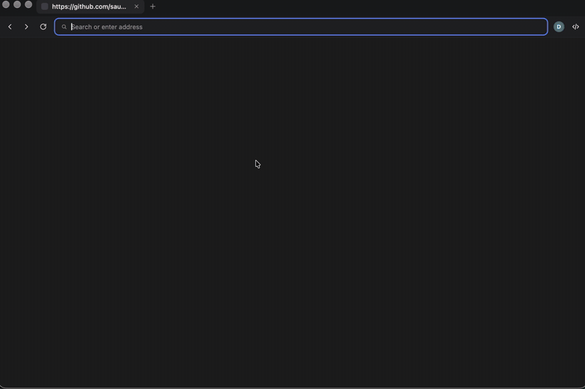

<div align="center">

# 🌅 Horizon

**A minimalist developer browser — all view, no weight.**

Tiny, fast, cross-platform browser for web development, built in C++ on each OS's
**native webview** — no bundled Chromium.

<br>



<br><br>


</div>

---

## Why Horizon

You already run Chrome for the heavy lifting. **Horizon is the lightweight pane
you keep open for your own app** — instant, quiet, and out of the way.

- 🪶 **Tiny & fast** — a ~1–2 MB bundle with no bundled engine; it uses only the
  system webview, so startup and memory are near-zero.
- 🧰 **Real DevTools** — the platform's native inspector (Chrome DevTools on
  Windows, WebKit Web Inspector on macOS, WebKitGTK inspector on Linux).
- 🪟 **Minimal chrome** — tabs sit in the title-bar row next to the window
  controls (Brave-style); nothing you don't need.
- 👤 **Profiles & 🕶 incognito** — isolated sessions mean you can be logged into
  the **same site under several accounts at once** (great for admin/user flows).
- 🔑 **Saved passwords** — captured on login, kept in the OS keychain, autofilled
  with a pick-to-fill suggestion.
- 🔍 In-page search, favicons, reopen-closed-tab, and full keyboard control.

## Build & run (macOS)

Requires CMake, Ninja and a C++23 compiler (Apple clang):

```sh
cmake -B build -G Ninja -DCMAKE_BUILD_TYPE=Release
cmake --build build
open build/Horizon.app
```

The chrome UI (`content/`) is compiled into the executable, so the app is a
single self-contained bundle — no external files at runtime.

> **Note:** the build is not code-signed, so on another Mac Gatekeeper will warn
> about an unidentified developer. Right-click → **Open** once, or run
> `xattr -dr com.apple.quarantine /path/to/Horizon.app`.

## Architecture

```
┌──────────────────────── native window ───────────────────────┐
│  shell webview  (content/) — tabs + toolbar (the browser UI)  │  chrome
├───────────────────────────────────────────────────────────────┤
│  content webview — active tab (one per tab, inactive hidden)  │
└───────────────────────────────────────────────────────────────┘
```

A single native window hosts a **shell** webview (the chrome — tab strip and
toolbar, an HTML/CSS/JS page embedded into the binary) plus one **content**
webview per tab. The C++ core (`src/main.cpp`) owns the tabs and drives them;
the shell talks to the core over [saucer](https://github.com/saucer/saucer)'s
JS↔C++ bridge (`window.saucer.exposed.*` → C++, `webview.execute(...)` → JS).

Session isolation (profiles, incognito) is a distinct `storage_path` per webview,
which saucer maps to a separate `WKWebsiteDataStore`. Native-only bits
(title-bar, keychain, focus, data wipe) live in `src/platform_mac.mm`.

```
CMakeLists.txt      # build: fetches saucer via CPM, embeds content/ into the binary
cmake/CPM.cmake     # dependency manager
src/main.cpp        # C++ core: windows, tabs, bridge, profiles, passwords
src/platform_mac.mm # macOS natives (title-bar, keychain, focus, data wipe)
content/            # chrome UI (index.html / style.css / app.js), embedded
assets/             # app icon: icon.svg + make_icons.py → .icns / .ico / .png
```

## Features

- **Tabs** — Chrome-style equal-width tabs beside the native window controls;
  create / close / switch with per-tab state, drag to reorder; new tabs open
  blank with the address bar focused.
- **Navigation** — smart address bar (URL / bare host → https / else search),
  back / forward / reload, favicons.
- **In-page search (⌘F)** — highlight, match counter, next / prev.
- **Profiles** — each profile is an isolated browsing context (cookies, storage,
  sessions) under `~/Library/Application Support/Horizon/profiles/<name>/`; one
  window per profile, last-used reopened on launch.
- **Incognito windows (⇧⌘N)** — ephemeral isolated sessions, all data wiped on
  close; each incognito window is a separate session, with no password vault.
- **Saved passwords** — stored in the **macOS keychain** (never on disk or in
  logs), namespaced per profile; autofill + pick-to-fill suggestion; "Never"
  list. Windows (Credential Manager) and Linux (libsecret) backends are TODO —
  elsewhere saving is in-memory only.
- **DevTools** — toggle button + right-click Inspect.

## Keyboard shortcuts

| Shortcut            | Action                   |
| ------------------- | ------------------------ |
| ⌘T / Ctrl+T         | New tab                  |
| ⇧⌘T / Ctrl+Shift+T  | Reopen last closed tab   |
| ⌘W / Ctrl+W         | Close current tab        |
| ⌘L / Ctrl+L         | Focus the address bar    |
| ⌘R / Ctrl+R         | Reload                   |
| ⌘\[ / ⌘\]           | Back / Forward           |
| ⌘1 … ⌘8             | Switch to tab 1 … 8      |
| ⌘9                  | Switch to the last tab   |
| Ctrl+Tab / Ctrl+⇧+Tab | Next / previous tab    |
| ⌘F / Ctrl+F         | Find on page             |
| ⌘N / Ctrl+N         | New window, same profile |
| ⇧⌘N / Ctrl+Shift+N  | New incognito window     |
| ⌘⌥I / Ctrl+Alt+I    | Toggle DevTools          |

Shortcuts are captured inside each webview (saucer exposes no window-level key
events) and routed to the C++ core over the bridge.

## Status

macOS is first-class today. The Windows (WebView2) and Linux (WebKitGTK) code
paths exist but their builds aren't verified yet, and the keychain backend is
macOS-only so far. See [`TODO.md`](TODO.md) for what's next.
